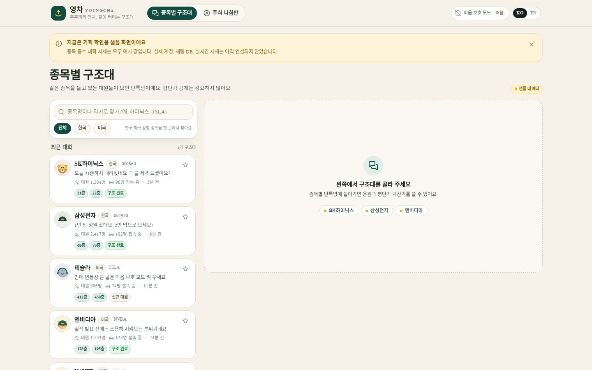
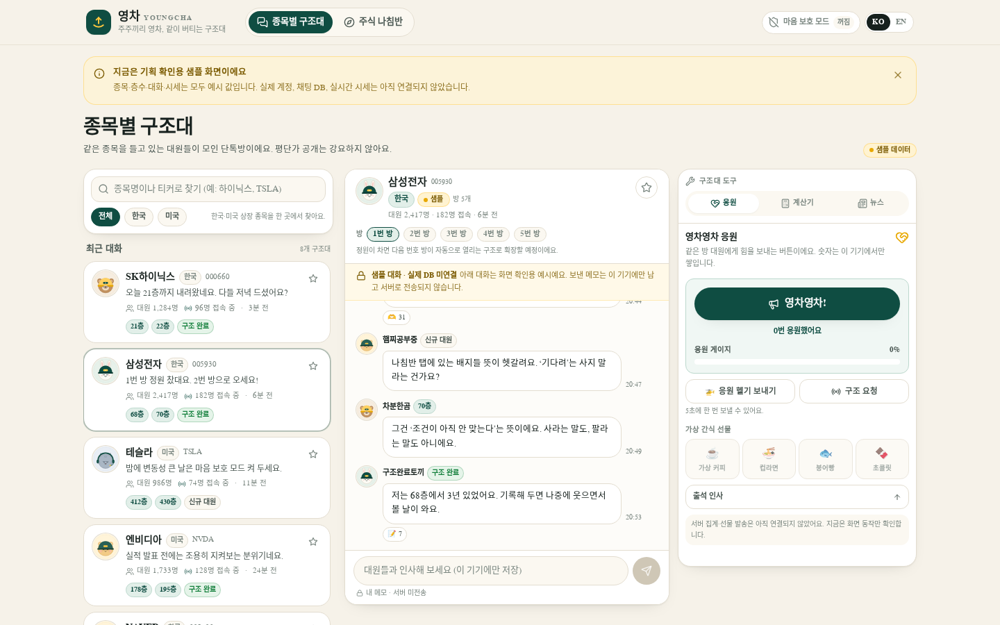
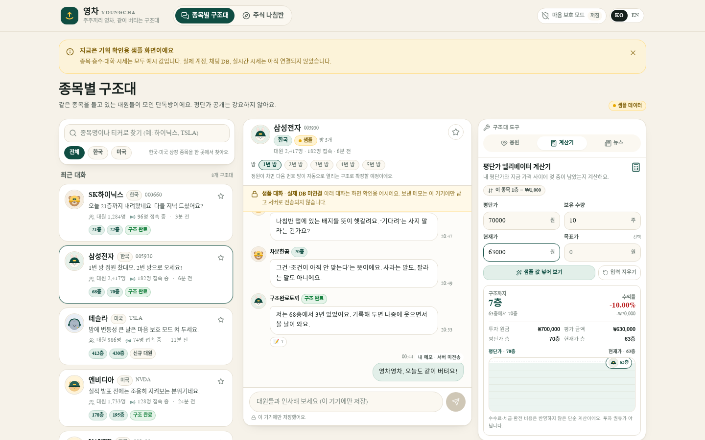
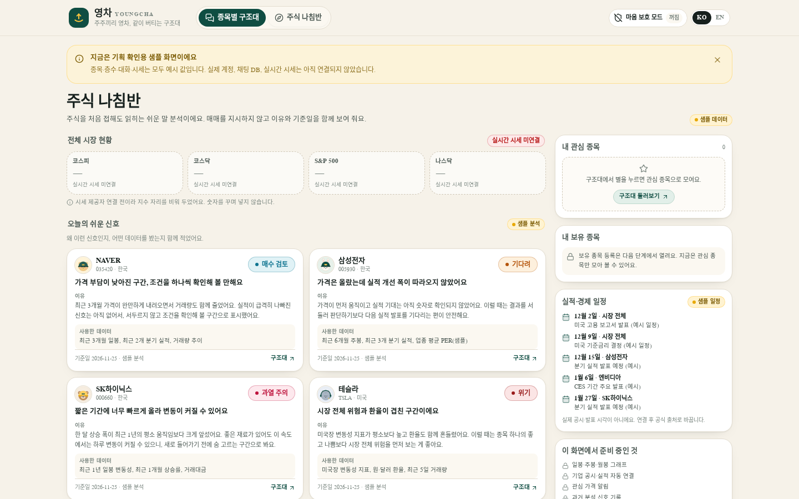
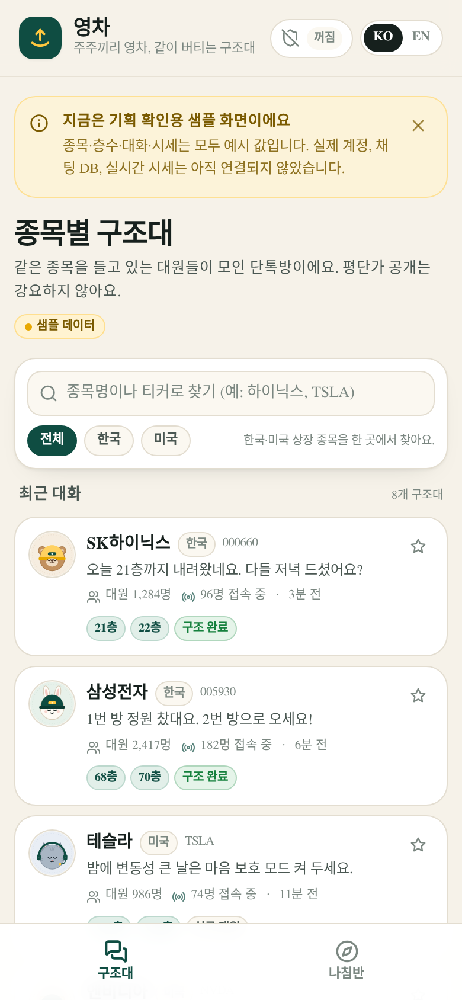
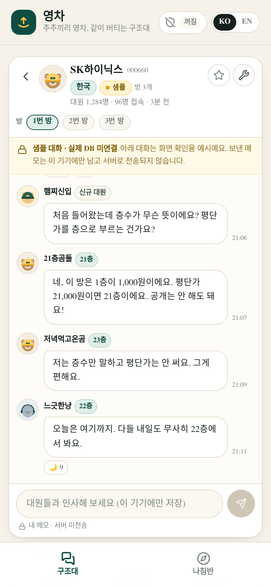
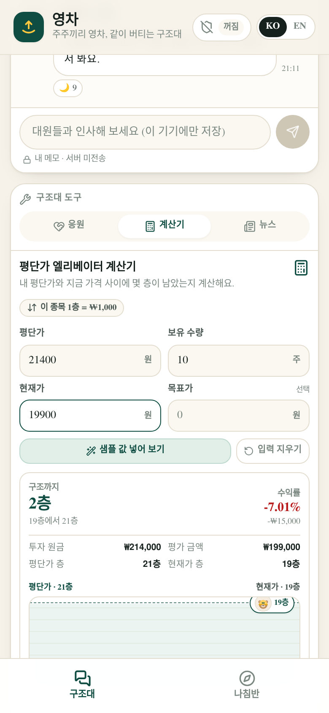

# 영차 YOUNGCHA

> **주주끼리 영차, 같이 버티는 구조대**
> 종목별 주주 단체 채팅(구조대)과, 주식을 처음 접해도 읽히는 쉬운 말 분석(주식 나침반)을 한 앱에 담은 서비스.
> 이 저장소는 **로렌(ChatGPT)·브리(Claude)가 이어서 디자인·캐릭터·세부 기능을 채우기 위한 뼈대(v0.1.0)**입니다.

| 항목 | 값 |
| --- | --- |
| 현재 버전 | `0.1.0` (skeleton) |
| 브랜치 | `main` (초기 커밋 완료, 원격 푸시는 메인에서 처리) |
| 기술 스택 | Vite 7 · React 19 · TypeScript 5.9 · Tailwind CSS v4 · lucide-react |
| 배포 대상 | Vercel (정적 프런트 + `api/health.ts` 서버리스 1개) |
| 비용 | 0원 — 유료 API·호스팅·이미지·데이터 이용권 없음 |
| 기준 문서 | `PROJECT_SPEC.md` (사용자 승인 기획), 상위 지침 「신규 수익화 웹앱 사업 통합 마스터 프로젝트 지침 v1.0」 |

---

## 1. 지금 무엇이 진짜인가 (가장 먼저 읽을 것)

지침 Ⅲ-13·Ⅴ에 따라 **실제 작동 / 샘플 / 미구현**을 화면과 문서에서 분리해 표시합니다.
화면 상단의 노란 안내("지금은 기획 확인용 샘플 화면이에요")와 각 카드의 `샘플` 배지가 같은 역할을 합니다.

### 실제로 작동하는 것

- **종목 검색·시장 필터** — `src/data/crews.ts`의 8개 샘플 종목 안에서 이름·티커·별칭 검색, 한국/미국 필터
- **구조대 목록 ↔ 채팅방 전환** — 데스크톱 2단, 모바일 1단(뒤로가기), 방(1·2·3…) 선택 표시
- **층 배지 표시** — 종목별 `1층 = 얼마` 설정에 맞춘 `21층 / 구조 완료 / 신규 대원` 배지
- **메모 전송** — 이 기기(localStorage)에만 저장되고 "서버 미전송"으로 표시
- **영차영차 응원** — 횟수·게이지가 이 기기에 저장됨, 응원 헬기 연출, 구조 요청 문구
- **평단가 엘리베이터 계산기** — 실제 계산: 투자 원금·평가 금액·손익·수익률·평단가 층·현재가 층·**구조까지 남은 층**
- **마음 보호 모드** — 층 배지·계산 결과를 가리고 응원 문구만 남김 (설정 유지)
- **관심 구조대(별)** — 저장, 관심 종목으로 나침반에 반영
- **한국어 / 영어 전환** — UI 문구 전체, 종목·대화 데이터도 함께 전환
- **`/api/health`** — 배포 시 서버리스 함수가 상태(모드·기능 플래그)를 JSON으로 응답

### 샘플·시뮬레이션 (실제 정보 아님)

- 대원 수·접속 수·최근 대화 시각, 채팅 대화 전부 (`src/data/messages.ts`)
- 층 배지 예시, 응원 수치, 구조 완료 인증서 문구
- 주식 나침반의 신호 7종과 이유·사용 데이터·기준일 (`src/data/signals.ts`)
- 실적·경제 일정 (`src/data/earnings.ts`), 세 줄 뉴스 (`src/data/news.ts`)
- 시장 지수 카드 — 값 대신 `—`와 "실시간 시세 미연결"만 표시(숫자를 꾸며 넣지 않음)

### 아직 구현되지 않은 것

- 실제 계정·로그인, 다중 사용자 채팅 저장(DB), 실시간 접속, 신고·차단
- 실시간 시세·종목 마스터 검색·차트(일/주/월봉)·공시, 관심 가격 알림, 과거 신호 기록
- 보유 종목 등록, 구조 완료 인증서 이미지, SNS 공유 카드, 실제 음료 쿠폰
- 유료 구독·결제 — **초기 화면에는 결제·광고·협찬사·수익 보장 문구를 넣지 않았습니다**

---

## 2. 화면

| 구조대 목록 (데스크톱 1440×900) | 구조대 채팅 + 응원 |
| --- | --- |
|  |  |

| 평단가 엘리베이터 계산기 | 주식 나침반 |
| --- | --- |
|  |  |

| 모바일 목록 (390×844) | 모바일 채팅 | 모바일 계산기 |
| --- | --- | --- |
|  |  |  |

---

## 3. 실행 방법

```bash
npm install
npm run dev        # http://localhost:5184  (모바일은 같은 네트워크에서 host:true)
npm run build      # 타입 검사(앱+API) + 프로덕션 빌드
npm run preview    # http://localhost:4184  (빌드 결과 확인)
npm run verify     # Playwright 검증 21개 + docs/screenshots 재생성
```

- Node 22 기준으로 확인했습니다.
- `npm run typecheck` = `tsc --noEmit`(앱) + `tsc -p tsconfig.api.json`(서버 함수)
- 검증 스크립트: `scripts/verify.py` (Python Playwright, Chromium)

---

## 4. 폴더 구조

```
youngcha/
├─ api/
│  └─ health.ts              # Vercel 서버리스: 모드·기능 플래그만 응답 (비밀값 노출 없음)
├─ public/
│  ├─ favicon.svg
│  └─ assets/characters/     # 자체 동물 대원 SVG 4종 + 교체 안내 README
├─ src/
│  ├─ api/client.ts          # /api/health 호출 + 미연결 지점 표시
│  ├─ components/
│  │  ├─ layout/             # AppHeader(탭·마음보호·언어), TabBar(모바일), SampleNotice
│  │  ├─ rescue/             # RescueScreen, CrewCard, ChatRoom, CheerPanel,
│  │  │                      # ElevatorCalculator, ToolsPanel
│  │  ├─ compass/            # CompassScreen (시장·신호·관심·일정·배지 안내)
│  │  └─ ui/                 # Card/SampleTag, CharacterAvatar, FloorBadgeChip
│  ├─ data/                  # crews, messages, signals, earnings, news (샘플 · ko/en)
│  ├─ i18n/                  # ko.ts(기본) · en.ts · index.tsx(Provider/useI18n)
│  ├─ lib/                   # elevator(계산), format, storage, usePersistentState, cn
│  ├─ styles/tokens.css      # ★ 디자인 토큰 단일 변경 지점
│  ├─ types.ts
│  ├─ App.tsx                # 탭 상태·관심·마음보호·샘플 안내 배선
│  └─ main.tsx / index.css
├─ docs/
│  ├─ screenshots/           # 검증 스크린샷 7장 (verify.py가 생성)
│  └─ ASSET_GUIDE.md         # 디자인·캐릭터·문구를 어디서 바꾸는지 (로렌용)
├─ scripts/verify.py         # 데스크톱/모바일 렌더·탭·계산기·마음보호 검증
├─ PROJECT_SPEC.md · ROADMAP.md · BACKLOG.md · CHANGELOG.md · TEST_REPORT.md
├─ .env.example              # 필요한 환경 변수 이름 (값 없음)
├─ vercel.json · tsconfig.json · tsconfig.api.json · vite.config.ts
```

---

## 5. 설계 원칙 (이 저장소에서 지킨 것)

1. **금융 조언으로 읽히지 않게** — "매수 검토/기다려/과열 주의"는 지시가 아니라 관찰 표시이며, 모든 신호에 이유·사용 데이터·기준일을 붙였습니다. 고점·저점·매매 날짜를 보장하지 않습니다.
2. **숫자를 꾸며 넣지 않음** — 실시간 시세가 없으면 `—`와 "미연결"을 보여 줍니다. 가상의 이용자 수·리뷰·시세를 실제처럼 표시하지 않습니다.
3. **평단가 공개 강요 없음** — 층 배지만 있고, 평단가·수량은 입력하지 않아도 됩니다. 입력값은 어디에도 전송되지 않습니다.
4. **마음 보호 모드** — 층수와 손익이 자책의 재료가 되기 쉬워, 한 번에 가릴 수 있게 했습니다.
5. **채팅은 단톡방 형태 유지** — 게시판으로 바꾸지 않았습니다. 단, DB·인증 전에는 "샘플 대화"로만 표시합니다.
6. **초기 무료** — 결제·광고·협찬·수익 보장 없음. 수익화는 검증 후 별도 단계.
7. **번역 분리** — UI 문구는 `src/i18n`, 데이터 문구는 `src/data`의 `ko/en` 필드. 화면 코드에 문구를 하드코딩하지 않았습니다.
8. **디자인 토큰 분리** — 색·글꼴·모서리는 `src/styles/tokens.css`만 고치면 전체에 반영됩니다.

---

## 6. 다른 AI가 이어받을 때 (로렌·브리)

1. **현재 브랜치와 최신 커밋, `PROJECT_SPEC.md`를 먼저 확인**합니다. (지침 Ⅵ)
2. 기존 기능을 삭제하거나 전체를 다시 만들지 않습니다. 변경은 별도 브랜치에서 합니다.
3. 작업 위치:
   - 색감·폰트·여백 → `src/styles/tokens.css`
   - 캐릭터 그림 → `public/assets/characters/*.svg` (파일 이름 유지)
   - 화면 구성 → `src/components/*`
   - 새 종목·대화·신호 → `src/data/*`
   - 문구 → `src/i18n/ko.ts` + `en.ts` (키를 양쪽에 함께 추가)
4. 작업 후 `npm run build`와 `npm run verify`를 통과시키고, `TEST_REPORT.md`·`CHANGELOG.md`·필요 시 `PROJECT_SPEC.md`를 갱신합니다.
5. 새 아이디어는 구조를 뒤엎지 말고 `BACKLOG.md`에 먼저 적습니다.

자세한 교체 지점은 [`docs/ASSET_GUIDE.md`](docs/ASSET_GUIDE.md).

---

## 7. 배포 (Vercel)

- 저장소를 Vercel에 연결하면 `vercel.json` 설정으로 빌드됩니다(`npm ci --include=dev` → `npm run build` → `dist`).
- `api/health.ts`는 Edge 함수로 배포되며, 환경 변수의 **설정 여부만** 알려 줍니다.
- 무료 Hobby 플랜 기준으로 설계했습니다. 상업 운영 전 무료 플랜의 상업적 이용 조건을 확인해야 합니다. (지침 Ⅲ-19)
- 배포 주소·원격 푸시는 이 뼈대 작업에서 수행하지 않았습니다(메인에서 처리).

---

## 8. 문서 지도

| 문서 | 내용 |
| --- | --- |
| [`PROJECT_SPEC.md`](PROJECT_SPEC.md) | 사용자 승인 기준 기획서 (화면·데이터·안전·승인 필요 항목) |
| [`ROADMAP.md`](ROADMAP.md) | 단계별 개발 계획과 각 단계 종료 조건 |
| [`BACKLOG.md`](BACKLOG.md) | 새 기능·후속 아이디어 (구조 변경 없이 여기에 먼저) |
| [`CHANGELOG.md`](CHANGELOG.md) | 변경 기록 (v0.1.0 뼈대) |
| [`TEST_REPORT.md`](TEST_REPORT.md) | 실제 테스트 결과·미해결 오류·미검증 항목 |
| [`.env.example`](.env.example) | 필요한 환경 변수 이름과 설정 안내 |
| [`docs/ASSET_GUIDE.md`](docs/ASSET_GUIDE.md) | 디자인·캐릭터·문구 교체 가이드 |

---

## 9. 고지

영차는 **투자 자문·중개 서비스가 아닙니다.** 화면의 모든 수치는 예시이며 실제 시세나 수익을 보장하지 않습니다.
집단 매매 선동, 무조건적인 추가 매수 권유, 허위 정보, 리딩방 홍보, 수익 보장은 서비스 정책으로 제한합니다.
